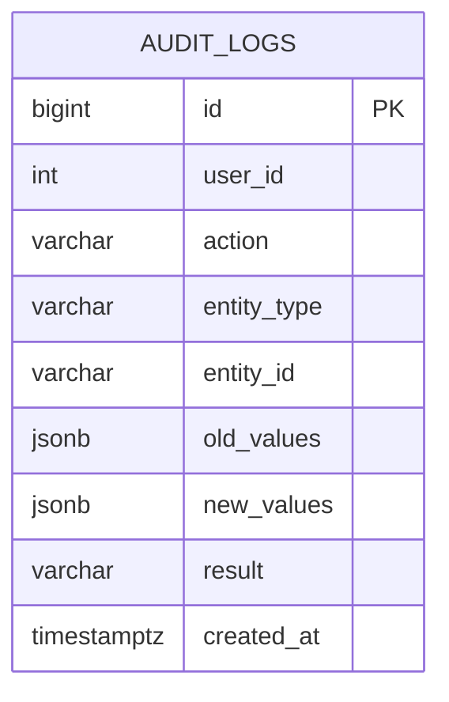

# Audit Logging Module — Database Design

## 1. Overview

This document defines the proposed database design for the Audit Logging module in StockWise v2.0.0.

The module will store historical records of relevant business operations and authentication events.

The design prioritizes traceability, data integrity, security, and efficient querying.

**Status:** Proposed — Pending implementation validation.

## 2. Database Strategy

The module will use the existing PostgreSQL database.

A new table named `audit_logs` will store audit events.

Audit records will be append-only through the application: records may be created and queried, but the application will not expose operations to modify or delete them.

The initial implementation will remain part of the existing modular monolith.

## 3. Audit Logs Table

**Table:** `audit_logs`

| Column | Data Type | Constraints | Description |
|---|---|---|---|
| id | BIGINT | Primary key | Unique audit event identifier |
| user_id | INTEGER | Nullable | Responsible user identifier |
| action | VARCHAR(50) | NOT NULL | Operation performed |
| entity_type | VARCHAR(100) | NOT NULL | Type of affected resource |
| entity_id | VARCHAR(100) | Nullable | Identifier of affected resource |
| old_values | JSONB | Nullable | Relevant previous values |
| new_values | JSONB | Nullable | Relevant new values |
| result | VARCHAR(20) | NOT NULL | SUCCESS or FAILURE |
| created_at | TIMESTAMPTZ | NOT NULL | Event timestamp in UTC |

### 3.1 Column Design Decisions

**id**

Uses BIGINT to support long-term growth in the number of audit records.

**user_id**

Stores the identifier of the responsible user when available.

It is nullable because failed authentication attempts may occur without an authenticated user.

The initial design does not enforce a foreign key to `users`, allowing historical audit events to remain independent of user lifecycle changes.

**action**

Identifies the operation performed.

Examples:

- CREATE
- UPDATE
- ACTIVATE
- DEACTIVATE
- INVENTORY_ENTRY
- INVENTORY_EXIT
- INVENTORY_ADJUSTMENT
- SALE_CREATE
- SALE_CANCEL
- LOGIN_SUCCESS
- LOGIN_FAILURE

The final action vocabulary must be standardized during implementation.

**entity_type**

Identifies the resource associated with the event.

Examples:

- USER
- PRODUCT
- CATEGORY
- INVENTORY_MOVEMENT
- SALE
- AUTHENTICATION

**entity_id**

Stores the affected resource identifier as text to support different entity identifier formats.

It may be null for events without an identifiable resource.

**old_values and new_values**

Use PostgreSQL JSONB to store relevant historical information.

These fields must contain explicitly selected, non-sensitive attributes rather than unrestricted serialization of application objects.

Passwords, password hashes, access tokens, and other secrets must never be stored.

**result**

Represents the outcome of the audited operation.

Initial supported values:

- SUCCESS
- FAILURE

**created_at**

Stores a timezone-aware timestamp representing the event time.

Application timestamps will follow UTC conventions.

## 4. Proposed SQL Structure

The following SQL illustrates the intended structure.

It is a design reference, not a migration script.

```sql
CREATE TABLE audit_logs (
    id BIGINT GENERATED BY DEFAULT AS IDENTITY PRIMARY KEY,
    user_id INTEGER NULL,
    action VARCHAR(50) NOT NULL,
    entity_type VARCHAR(100) NOT NULL,
    entity_id VARCHAR(100) NULL,
    old_values JSONB NULL,
    new_values JSONB NULL,
    result VARCHAR(20) NOT NULL,
    created_at TIMESTAMPTZ NOT NULL DEFAULT CURRENT_TIMESTAMP,

    CONSTRAINT ck_audit_logs_result
        CHECK (result IN ('SUCCESS', 'FAILURE'))
);
```

## 5. Indexing Strategy

The following indexes are proposed to support administrative queries:

```sql
CREATE INDEX ix_audit_logs_user_id
    ON audit_logs (user_id);

CREATE INDEX ix_audit_logs_entity
    ON audit_logs (entity_type, entity_id);

CREATE INDEX ix_audit_logs_action
    ON audit_logs (action);

CREATE INDEX ix_audit_logs_created_at
    ON audit_logs (created_at DESC);
```

Index selection will be reviewed against actual query patterns and database performance.

## 6. Relationship with Existing Entities

The audit module references existing business entities through identifiers.

These references are intentionally stored without foreign key constraints in the initial design.

This allows audit records to preserve historical identifiers even when related business data changes.

### Conceptual Diagram



The diagram represents the proposed audit table, not a physical relationship enforced through foreign keys.

## 7. Transaction Consistency

Successful business operations and their corresponding audit records must be persisted consistently.

The preferred strategy is to create the audit record within the same database transaction as the business change.

If the business transaction is rolled back, its successful audit event must also be rolled back.

Authentication failures require separate handling because they do not necessarily involve a successful business transaction.

The exact transaction boundaries will be reviewed against the existing repository and session management implementation.

## 8. Data Protection

Audit data must follow these rules:

- Never store passwords or password hashes.
- Never store JWT access tokens.
- Never store complete authentication request bodies.
- Record only explicitly approved fields.
- Restrict audit queries to administrators.
- Do not expose update or delete operations for audit records.
- Avoid including unnecessary personal information in historical snapshots.

## 9. Query Requirements

The database design must support:

- Filtering by responsible user
- Filtering by entity type
- Filtering by action
- Filtering by date range
- Combined filters
- Paginated results
- Sorting by newest events first

Pagination parameters and API response structure will be defined in the API contract.

## 10. Implementation Considerations

Before creating the Alembic migration, verify:

1. The existing `users.id` database type.
2. Current SQLAlchemy model conventions.
3. Existing database session and transaction boundaries.
4. The project's timestamp conventions.
5. The expected volume and retention requirements for audit data.

The final migration must follow existing project conventions and must not introduce unnecessary schema changes.

## 11. Out of Scope

The initial design does not include:

- Audit record partitioning
- A dedicated audit database
- External log streaming
- Automatic audit record deletion
- Database-level immutability enforcement
- Real-time event processing

These capabilities may be evaluated as operational requirements evolve.

## 12. Implementation Status

**Status:** Proposed — Not implemented.

No database migration or SQLAlchemy model has been created at this stage.
